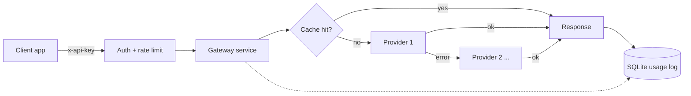

# llm-gateway-fastapi

[](https://github.com/JamshaidBasit01/llm-gateway-fastapi/actions/workflows/ci.yml)


One API in front of **OpenAI, Anthropic, Gemini and Groq**. Applications call a single `/v1/chat` endpoint; the gateway handles provider differences, **retries and fallback**, **response caching**, **per-client rate limiting** and **token and cost tracking**.

## Why a gateway

Calling four vendor SDKs directly means four request formats, four error behaviours and no shared view of spend. A thin gateway gives you:

- **One request and response shape** for every provider.
- **Resilience**: transient failures are retried with backoff, and a failing provider falls through to the next one in the route.
- **Lower cost and latency** for repeated prompts via a cache that is isolated per client.
- **Visibility**: tokens, cost, cache hit rate and errors per client.
- **Control**: API-key auth and rate limits in one place, with provider keys never leaving the server.

## Architecture



Providers are plain adapters behind a small `Provider` interface (`providers/`), so adding one is a single file.

## Quick start (no API keys needed)

```bash
git clone https://github.com/JamshaidBasit01/llm-gateway-fastapi.git
cd llm-gateway-fastapi
python -m venv .venv && source .venv/bin/activate
pip install -e ".[dev]"

export ENABLE_MOCK=true GATEWAY_API_KEYS=demo:demo-key
uvicorn --factory llm_gateway.app:create_app --port 8000
```

Interactive API docs: <http://localhost:8000/docs>

```bash
curl -s localhost:8000/v1/chat \
  -H 'x-api-key: demo-key' -H 'content-type: application/json' \
  -d '{"messages":[{"role":"user","content":"hello"}]}'
```

The mock provider echoes your message. A message containing `[fail]` simulates an outage, which lets you watch retries and fallback without spending anything.

## Use real providers

Copy `.env.example` to `.env`, then set the **key and model** for each provider you want (both are required, model ids are yours to choose from the provider's docs):

```bash
OPENAI_API_KEY=...        OPENAI_MODEL=...
ANTHROPIC_API_KEY=...     ANTHROPIC_MODEL=...
GEMINI_API_KEY=...        GEMINI_MODEL=...
GROQ_API_KEY=...          GROQ_MODEL=...
DEFAULT_ROUTE=anthropic,openai,groq        # optional: order to try
GATEWAY_API_KEYS=alice:<long-random-key>   # clients allowed to call the gateway
```

Run with Docker (gateway + Redis cache):

```bash
docker compose up --build
```

## API

| Method | Path | Auth | Purpose |
|---|---|---|---|
| `POST` | `/v1/chat` | yes | Chat completion with routing, cache and cost tracking |
| `GET` | `/v1/usage` | yes | Your tokens, cost, cache hit rate and errors |
| `GET` | `/v1/providers` | yes | Enabled providers and the default route |
| `GET` | `/health` | no | Liveness check |

Send the key as `x-api-key: <key>` or `Authorization: Bearer <key>`.

### `POST /v1/chat`

```json
{
  "messages": [
    {"role": "system", "content": "Answer in one sentence."},
    {"role": "user", "content": "What is hybrid search?"}
  ],
  "targets": [{"provider": "anthropic"}, {"provider": "openai", "model": "my-model-id"}],
  "temperature": 0,
  "max_tokens": 256,
  "cache": true
}
```

`targets` is optional (default: `DEFAULT_ROUTE`). The response:

```json
{
  "content": "...",
  "provider": "openai",
  "model": "...",
  "usage": {"prompt_tokens": 21, "completion_tokens": 18},
  "total_tokens": 39,
  "cost_usd": 0.000123,
  "latency_ms": 812.4,
  "cached": false,
  "attempts": [
    {"provider": "anthropic", "model": "...", "ok": false, "status_code": 529, "error": "...", "latency_ms": 310.2},
    {"provider": "openai", "model": "...", "ok": true, "latency_ms": 498.0}
  ]
}
```

`attempts` shows exactly which providers were tried, so fallbacks are never hidden. If every provider fails the gateway returns `502` with the same attempt list.

## Behaviour worth knowing

- **Retries**: network errors, timeouts, `429` and `5xx` are retried on the same provider (`MAX_RETRIES`, exponential backoff), then the next provider is tried. Other `4xx` errors are not retried.
- **Cache**: only requests with `temperature: 0` are cached. The key covers the client, route, messages, temperature and `max_tokens`, so **one client never receives another client's cached answer**. In-memory by default (per process); set `REDIS_URL` to share across workers.
- **Cost**: computed from a price table you provide (`PRICING_FILE`, see `prices.example.json`). Prices change often, so none are built in. A model with no price entry reports `cost_usd: null` and is counted under `unpriced_requests` instead of being guessed. Cache hits cost `0` and the avoided spend is reported as `estimated_saved_usd`.
- **Auth**: constant-time key comparison. The gateway **refuses to start** with no client keys unless you explicitly set `GATEWAY_AUTH_DISABLED=true` (development only).
- **Rate limit**: fixed window per client (`RATE_LIMIT_PER_MINUTE`), `429` with `Retry-After`.
- **Secrets**: provider keys are read from the environment, sent only in request headers, kept out of `repr()` and error messages.

## Configuration

| Variable | Default | Meaning |
|---|---|---|
| `<PROVIDER>_API_KEY` / `_MODEL` | – | Enable a provider (both required) |
| `<PROVIDER>_BASE_URL` | vendor URL | Override the endpoint (proxies, compatible servers) |
| `<PROVIDER>_OMIT_TEMPERATURE` | `false` | Stop sending `temperature` for models that reject it |
| `ENABLE_MOCK` | `false` | Enable the offline echo provider |
| `DEFAULT_ROUTE` | all enabled | Comma separated provider order |
| `GATEWAY_API_KEYS` | – | `label:key` pairs allowed to call the gateway |
| `RATE_LIMIT_PER_MINUTE` | `60` | Per client, `0` disables |
| `CACHE_TTL_SECONDS` / `CACHE_MAX_ITEMS` | `3600` / `1000` | Cache lifetime and size |
| `REDIS_URL` | – | Use Redis for the cache |
| `REQUEST_TIMEOUT` / `MAX_RETRIES` / `RETRY_BACKOFF_SECONDS` | `30` / `1` / `0.5` | Upstream call behaviour |
| `PRICING_FILE` | – | JSON price table for cost tracking |
| `DB_PATH` | `gateway_usage.db` | SQLite usage log |

## Tests

```bash
ruff check .
pytest -q
```

40 tests cover auth, rate limiting, caching (including cross-client isolation), retry and fallback, cost maths and each provider adapter's request and response mapping. Provider calls are answered by a fake HTTP transport, so **the suite needs no network and no API keys**.

## Project layout

```text
src/llm_gateway/
  app.py          FastAPI app, auth + rate-limit dependency, endpoints
  service.py      cache -> retry -> fallback -> cost -> usage log
  config.py       environment settings and startup validation
  providers/      openai_compat (OpenAI, Groq), anthropic, gemini, mock
  cache.py        memory (TTL + LRU) and Redis caches
  pricing.py      price table and cost calculation
  usage.py        SQLite request log and per-client summary
  security.py     API-key auth and fixed-window rate limiter
  schemas.py      request and response models
tests/            pytest suite (offline)
```

## Limitations

- Non-streaming chat only; no tool calling or image input yet.
- The rate limiter and in-memory cache are per process. Run one worker, or use Redis for the cache, when exact limits matter.
- Provider adapters are tested against recorded request/response shapes, not live vendor APIs. Verify a provider with your own key before depending on it, and keep model ids and prices current.
- `GET /v1/usage` reports per-client totals only; there is no admin view across clients.

## Roadmap

- [ ] Server-sent-event streaming
- [ ] Tool / function calling pass-through
- [ ] Shared (Redis) rate limiter
- [ ] Prometheus metrics endpoint

## License

MIT, see [LICENSE](LICENSE).
